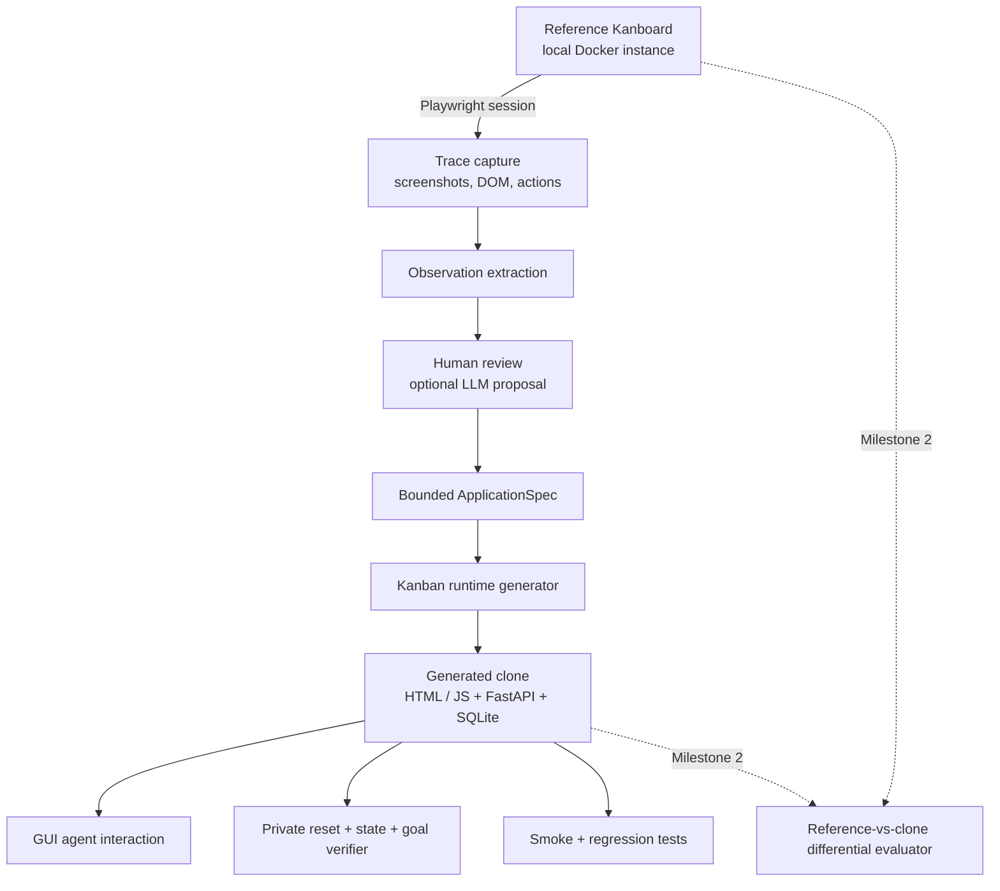

# Trace-to-Clone

### A research prototype for reconstructing verifiable, stateful web applications from interaction evidence

**Milestone 1 · Kanboard-inspired task environment · Work in progress**

The long-term goal of **Trace-to-Clone** is to take an existing web application, observe how it looks and behaves, and automatically generate a **runnable synthetic clone** that a computer-use agent can navigate. Unlike a static screenshot or mockup, the clone should maintain state, support multi-step tasks, reset to a known starting point, and expose a private verifier that can check whether an agent actually achieved a goal.

The motivation is to create realistic, inexpensive, controllable environments for **agent evaluation, trajectory generation, and eventually reinforcement learning**. The key research challenge is not simply generating a similar-looking interface: it is inferring and reproducing the application's *behavioral model* from limited observations.

> **Honest status:** This is a **bounded first deliverable**, not a general autonomous website cloner. The executable Kanban specification was **manually curated** from documented task/board behavior. The trace collector and observation extractor are implemented, but no live Kanboard-to-clone reconstruction or differential evaluation was completed in the initial build. The generator currently uses a reusable **Kanban-specific template**, not arbitrary UI/code synthesis. See [What this proves](#what-this-prototype-demonstrates) and [Limitations](#current-limitations).

## In one minute

**Input, today:** a reviewed JSON specification for a small Kanban app, plus optional captured browser evidence from a reference app.

**Output, today:** a generated, runnable HTML/CSS/JavaScript + FastAPI + SQLite app with task workflows, private reset/state/verification endpoints, and tests.

**Intended future input:** only an authorized application's URL (and, optionally, an exploration budget or task scope).

**Intended future output:** a visually and behaviorally faithful, automatically generated synthetic application and a reproducible set of verified agent tasks.

### A concrete task the clone can support

> Create a task named **Fix authentication bug**, set its priority to **P0**, move it to **Work in progress**, and close it.

A GUI agent can interact with the task board. A **separate verifier** can query the internal task record and confirm the title, priority, column, and closed status. The agent should **not** have access to the verifier key or internal-state endpoint.

## Quick start: run the clone

**Requirements:** [Python 3.10+](https://www.python.org/downloads/) and [Git](https://git-scm.com/downloads). **Docker, an API key, and browser automation are not required** to run the generated clone. The commands below start from a fresh checkout.

### 1. Clone the repository

Open a terminal and run:

```bash
git clone https://github.com/ShomikTelang/trace-to-clone.git
cd trace-to-clone
```

This downloads the repository from GitHub and moves into its **repository root** (the folder containing `README.md` and `pyproject.toml`). You do **not** need a separate ZIP. If you already cloned it, open a terminal in the existing `trace-to-clone` folder and skip this step.

### 2. Create and activate a virtual environment

**macOS / Linux:**

```bash
python3 -m venv .venv
source .venv/bin/activate
```

**Windows PowerShell:**

```powershell
py -m venv .venv
.venv\Scripts\Activate.ps1
```

The virtual environment isolates project dependencies from other Python installations. On later runs, activate the existing environment instead of recreating it.

### 3. Install dependencies

With the virtual environment activated:

```bash
python -m pip install -e '.[test]'
```

### 4. Start the generated clone

```bash
python -m traceclone demo
```

Open **http://localhost:8000**. The demo command generates the bounded application from `specs/kanboard_mvp.json` the first time it runs and then starts a local server. Keep this terminal running; press `Ctrl+C` to stop it.

Try creating a task with a title, description, priority, and tags; moving it between **Backlog**, **Ready**, **Work in progress**, and **Done**; editing it; and closing/reopening it. Refresh the browser to see SQLite persistence in action.

### 5. Run the tests (optional)

**Keep the server running in the first terminal.** In a second terminal, navigate to the repository root, activate the same virtual environment, and run:

```bash
# macOS / Linux
source .venv/bin/activate
python -m traceclone evaluate --url http://localhost:8000
python -m pytest -q
```

On Windows PowerShell, use `.venv\Scripts\Activate.ps1` to activate the environment instead.

**Important:** `evaluate` resets the demo database before and after its smoke checks, so do not use it if you need to preserve manual tasks. The checks validate the **clone's own behavior**, not equivalence to real Kanboard.

### Optional: browser-level validation

```bash
python -m pip install -e '.[all]'
python -m playwright install chromium
python -m traceclone evaluate --url http://localhost:8000 --gui \
  --screenshot artifacts/gui_smoke.png
```

If you use a preinstalled Chromium, set `CHROMIUM_PATH=/absolute/path/to/chromium`. Browser execution depends on the host environment. GUI tests were **not** successfully executed in the initial artifact-building environment, so they are **not** included in the passing-test claim.

### Optional: run real Kanboard with Docker

The generated clone runs without Docker. To launch **real Kanboard** separately as a reference for exploration and future fidelity comparisons, install and start [Docker Desktop](https://www.docker.com/products/docker-desktop/) (or Docker Engine with Compose), then run:

```bash
docker compose -f reference/compose.yml up -d
```

Open **http://localhost:8081**. This reference application is independent of your generated clone at `http://localhost:8000`.

Stop the reference container with:

```bash
docker compose -f reference/compose.yml down
```

For guided workflow recording and observation extraction, see [From a real Kanboard instance to evidence](#from-a-real-kanboard-instance-to-evidence).

## What is implemented?

| Component | Included today | Purpose |
| --- | --- | --- |
| **Reference environment** | Docker Compose definition for a pinned Kanboard image | Controlled source application for future comparisons |
| **Browser evidence collector** | Guided or scripted Playwright sessions | Capture screenshots, DOM samples, URLs, visible controls, selected network metadata, interaction events |
| **Observation extractor** | Deterministic trace-to-observation draft | Describe observed pages/controls without inventing hidden backend behavior |
| **Optional model-assisted proposal** | OpenAI API integration (opt-in) | Propose a bounded spec; **not** trusted without review |
| **Application specification** | `specs/kanboard_mvp.json` | Define columns, priorities, fields, actions, and initial tasks |
| **Clone generator** | Template-driven, Kanban-specific | Generate a new executable app instance from a reviewed spec |
| **Stateful clone runtime** | FastAPI + SQLite + vanilla JS/CSS/HTML | Task create/edit/move/close/reopen, persistence, UI interactions |
| **Privileged verifier** | Protected local endpoints | Reset, inspect internal state, and check task-goal predicates |
| **Evaluation** | API smoke checks + pytest + optional Playwright GUI smoke | Verify key clone behaviors and reproducibility |
| **Reference differential testing** | **Not implemented yet** | Future test of whether the clone truly matches Kanboard |
| **Autonomous exploration, visual repair, RL training** | **Not implemented yet** | Future research milestones |

### Supported clone behaviors

- A single project board with configurable columns and priorities.
- Create a task with title, description, priority, column, and tags.
- Edit task properties and move tasks between columns (including drag-and-drop in the UI).
- Close and reopen tasks; closed tasks remain in storage and can be listed explicitly.
- Search and filter tasks, and keep state after refresh or server restart.
- Record state-changing actions in a persistent event/audit log.
- Reset the app to deterministic seed data and query goal predicates through a private verifier API.

The clone is **Kanboard-inspired**. Its appearance and interactions are not claimed to be pixel-identical to the current Kanboard product.

## Architecture



**Key architectural rule:** the agent's interaction surface and the verifier's privileged state access are separate. A computer-use agent acts through the visible application; the trusted evaluator checks the resulting state through restricted endpoints.

The intermediate `ApplicationSpec` is important because it separates three failure modes: **observation/inference errors**, **code-generation errors**, and **evaluation errors**. Future work should attach evidence and uncertainty to every inferred behavioral rule.

## From a real Kanboard instance to evidence

### 1. Start Kanboard locally

You need Docker Engine/Desktop with Compose:

```bash
docker compose -f reference/compose.yml up -d
```

Visit **http://localhost:8081**. Set up a **disposable test project** named `Clone Research`, preferably using the columns `Backlog`, `Ready`, `Work in progress`, and `Done`. The reference instance's actual onboarding and fields may differ from the clone's simplified model.

The reference container is independent of the generated clone. Stop it with:

```bash
docker compose -f reference/compose.yml down
```

This keeps Docker volumes by default.

### 2. Record a guided workflow

Install the optional tools and capture an authenticated test session:

```bash
python -m pip install -e '.[all]'
python -m playwright install chromium
python -m traceclone login --url http://localhost:8081
```

Log into your **local, disposable** reference account in the opened browser. Press Enter in the terminal to save session state to `reference/storage-state.json` (**git-ignored; never commit it**).

Then record:

```bash
python -m traceclone record \
  --url http://localhost:8081 \
  --headed \
  --storage-state reference/storage-state.json \
  --out artifacts/reference_trace
```

Follow [`workflows/kanboard_reference_guide.md`](workflows/kanboard_reference_guide.md): open the board, create a task, inspect it, move it, and close it. At each checkpoint, type a label in the terminal and press Enter; enter `done` to finish.

The trace directory contains `trace.json`, page screenshots, bounded HTML snapshots, and a Playwright trace archive. These can contain sensitive information even though request bodies and passwords are not intentionally logged. **Review captures before uploading or sharing.** The entire `artifacts/` directory is git-ignored.

A scripted recording is also supported using a JSON workflow:

```bash
python -m traceclone record \
  --url http://localhost:8000 \
  --workflow workflows/clone_smoke.json \
  --out artifacts/clone_trace
```

`clone_smoke.json` contains **clone selectors**, not validated real-Kanboard selectors. Scripted reference replay requires a separate workflow derived from observed Kanboard elements.

### 3. Extract observations or an optional proposal

```bash
python -m traceclone infer \
  --trace artifacts/reference_trace/trace.json \
  --out artifacts/inference_draft.json
```

This deterministic extraction returns observed pages, control labels, form fields, and event counts. It explicitly marks unknown backend semantics. **It does not automatically produce a verified, executable specification.**

To try model-assisted proposal generation:

```bash
export OPENAI_API_KEY='your_key_here'
python -m traceclone infer --llm --model gpt-4.1-mini \
  --trace artifacts/reference_trace/trace.json \
  --out artifacts/inference_with_proposal.json
```

The API key is optional; do not commit it. The LLM receives a reduced observation summary, not full screenshots or cookies. Review and correct its `llm_proposal` against real application evidence before attempting to use it for generation. Note that the inference output is **not directly accepted** as an executable spec without adapting/reviewing it to the Kanban schema.

### 4. Generate from the reviewed spec

```bash
python -m traceclone generate \
  --spec specs/kanboard_mvp.json \
  --out generated/kanboard-clone
```

If you have already run `demo`, the output directory exists. To intentionally replace it:

```bash
python -m traceclone generate \
  --spec specs/kanboard_mvp.json \
  --out generated/kanboard-clone --force
```

**Warning:** `--force` replaces the entire generated directory, including the SQLite database. Back up data and stop the server first.

You can edit the spec to change columns, priorities, seed tasks, and supported metadata. The same Kanban runtime template is copied to the generated directory. This is **spec-parameterized template generation**, not general LLM-based website implementation.

## State inspection, reset, and verification

A realistic agent playground needs two interfaces:

1. A **public GUI/API**, through which the agent performs ordinary application actions.
2. A **privileged verifier**, used only by the evaluation system for state queries, resets, and goal checking.

The demo verifier endpoints are protected by an `X-Verifier-Key` header. The **development-only** default is `local-dev-verifier`. For anything beyond localhost, configure a secret `VERIFIER_KEY` and add real isolation; this MVP is **not** a secure multi-tenant service.

```bash
# Return to deterministic initial tasks
curl -X POST http://localhost:8000/internal/reset \
  -H 'X-Verifier-Key: local-dev-verifier'

# See tasks and event history
curl http://localhost:8000/internal/state \
  -H 'X-Verifier-Key: local-dev-verifier'

# Check whether a matching closed task exists
curl -X POST http://localhost:8000/internal/verify \
  -H 'X-Verifier-Key: local-dev-verifier' \
  -H 'Content-Type: application/json' \
  -d '{"task":{"title":"Fix authentication bug","column":"Work in progress","priority":"P0","is_active":false}}'
```

The verifier supports matching task fields and tag-subset predicates. The browser UI does not call these endpoints, and the agent should never be provided with the verifier key.

## What this prototype demonstrates

**Demonstrated by automated tests in the initial build:**

- A structured, reviewed Kanban spec can generate an independently runnable instance.
- A generated app can handle meaningful state-changing actions and retain data in SQLite.
- State changes are externally visible through the UI/API and internally observable to a separate verifier.
- A deterministic reset and task-goal checker can support repeatable agent evaluations.
- Browser traces can be reduced into a conservative observation draft without claiming hidden behavior was recovered.

**Not demonstrated yet:**

- Automatically inferring Kanboard's actual persistent state model from a live browser session.
- Producing an executable clone directly from raw traces without manual spec review.
- Behavioral equivalence, screenshot fidelity, or task-success transfer between real Kanboard and the clone.
- Generality across unfamiliar applications, automatic repair, or RL learning gains.

This distinction matters: a verifier that checks the clone's *own* state proves that a goal was achieved **inside the clone**. It does **not**, by itself, prove that the clone faithfully reproduces the reference application.

### Tests and reproducibility

In the initial build, **6 pytest tests and 9 API smoke checks passed**. Tests cover generation from specs, initial state, create/move/close/reopen, validation, deterministic reset, privileged verifier access, and conservative trace inference. No real-Kanboard differential or Chromium browser pass is claimed.

GitHub Actions runs the Python tests automatically on pushes and pull requests. The current CI does **not** start Docker or perform visual/reference comparisons.

## Project structure

```text
traceclone/
├── README.md                       # Project overview, setup, architecture, status
├── pyproject.toml                  # Python package and optional dependencies
├── Makefile                        # Local development shortcuts
├── .github/workflows/ci.yml       # Python test CI
├── reference/compose.yml          # Real Kanboard via Docker Compose
├── specs/kanboard_mvp.json        # Manually reviewed bounded application spec
├── workflows/
│   ├── kanboard_reference_guide.md # Guided reference capture scenario
│   └── clone_smoke.json           # Scripted workflow for the clone
├── traceclone/
│   ├── cli.py                      # demo / record / infer / generate / evaluate commands
│   ├── capture.py                  # Playwright screenshots, DOM, action evidence
│   ├── infer.py                    # Observation draft, optional LLM proposal
│   ├── generate.py                 # Kanban-specific code generation
│   └── evaluate.py                 # API and optional GUI smoke tests
├── templates/kanban_runtime/      # Reusable full-stack application template
├── tests/test_clone.py            # Backend, generator, verifier tests
├── docs/research_plan.md          # Research questions, methodology, milestone 2
└── generated/                     # Local generated applications (git-ignored)
```

## Roadmap

| Milestone | Goal | Concrete exit criterion | Status |
| --- | --- | --- | --- |
| **M1 — Stateful synthetic app** | Runtime + spec + traces + verifier | Local app runs; independent API unit/smoke tests pass | **Implemented (bounded)** |
| **M2 — Differential evaluation** | Compare real Kanboard and clone on matched workflows | Same independently specified tasks replayed; reference/clone state and UI differences reported | **Next** |
| **M3 — Trace-to-spec automation** | Infer transitions and data semantics from browser evidence | Executable spec recovered for held-out Kanboard workflows with limited manual intervention | Planned |
| **M4 — Automatic fidelity repair** | Iterative generation, replay, mismatch diagnosis, repair | Measurable reduction in functional and visual errors across iterations | Planned |
| **M5 — Cross-app generalization** | Clone a different application category | Same pipeline works without custom per-app implementation logic | Planned |
| **M6 — Agent/RL evaluation** | Use generated environments as reproducible agent playgrounds | Verified task suite and measured transfer to held-out/reference workflows | Planned |

### Immediate next step: M2, reference-vs-clone differential evaluation

This should come **before** autonomous exploration or RL training:

1. Launch a disposable Kanboard reference with known seed tasks and columns.
2. Build and validate *reference-specific* Playwright locators for 5–10 task workflows.
3. Define a canonical representation for task actions (`create_task`, `move_task`, `close_task`) and expected postconditions, independent of either application's implementation.
4. Replay equivalent actions against the reference and clone, using separate GUI mappings.
5. Compare matching screens and semantic results; record failures, screenshots, elapsed time, and cost.
6. Classify each mismatch as an **observation/spec**, **generator**, **UI**, or **state/verifier** error.
7. Use those reports to guide spec correction and eventually automatic repair.

For a rigorous first experiment, hold out some workflows and seed data **not used to define the generation spec**. Otherwise the clone can appear accurate simply because the evaluator repeats the assumptions used during generation.

### Research questions to investigate

- **Efficient exploration:** How many browser interactions are needed to infer task-relevant behavior? Can uncertainty-guided exploration beat breadth-first discovery?
- **State inference:** Which backend state, validation rules, and persistence semantics can be recovered from GUI traces alone?
- **Fidelity:** How should visual similarity and behavioral correctness be combined without letting a high screenshot score hide broken workflows?
- **Representation:** When is a finite-state machine sufficient, and when are symbolic entities and precondition/effect rules necessary to avoid combinatorial growth?
- **Transfer:** Does training on a higher-fidelity clone actually improve success on held-out tasks in the real application?
- **Efficiency:** What does reliable clone generation cost in model tokens, compute, browser steps, latency, and human review?

See [docs/research_plan.md](docs/research_plan.md) for more detailed experiment design and caveats.

## Current limitations

- **Domain restriction:** the code generator supports a single Kanban/task runtime, not arbitrary websites.
- **Human-supplied behavioral semantics:** `kanboard_mvp.json` is curated, not discovered by the trace inference stage.
- **UI fidelity:** the provided frontend is inspired by Kanboard and has not been compared pixel-by-pixel against the reference.
- **Incomplete reference coverage:** multi-project navigation, attachments, comments, accounts, complex permissions, and advanced Kanboard features are outside the MVP.
- **No reference differential test:** browser capture exists, but real-vs-clone replay is a future deliverable.
- **No RL environment interface or agent training:** the internal reset/verifier APIs are building blocks, not a complete Gym-compatible environment.
- **Development-grade isolation:** no strong tenancy boundary, secure account handling, or hardened verifier service yet.

## Security and data handling

- Run exploration only against applications you own or are authorized to test, using **disposable test accounts and synthetic data**.
- Browser screenshots and HTML can contain private or copyrighted data. Do not publish them without reviewing and obtaining appropriate permission.
- `reference/storage-state.json`, `.env`, local databases, `artifacts/`, and `generated/` are excluded by `.gitignore`.
- The demo verifier token is **not secure**. Do not publicly deploy this service with its default key; bind it locally during development.
- The optional LLM proposal requires an API key and shares a reduced observations summary with the provider. Avoid putting secrets or private content in traces.

## Publish on GitHub

This project is designed to be committed **from its repository root**. The generated clone and captured browser data are intentionally excluded from Git history; anyone who clones the repo can regenerate the demo with `python -m traceclone demo`.

**Option A: GitHub CLI** (after signing in with `gh auth login`):

```bash
git init
git add .
git commit -m "Initial Trace-to-Clone Kanboard research prototype"
git branch -M main
gh repo create trace-to-clone --private --source=. --remote=origin --push
```

Change `--private` to `--public` when you're ready to share the project. A private repository is a sensible default while reference captures and application behavior are still being studied.

**Option B: GitHub website:** Create an **empty** repository on GitHub (no automatically generated README), then:

```bash
git init
git add .
git commit -m "Initial Trace-to-Clone Kanboard research prototype"
git branch -M main
git remote add origin https://github.com/YOUR_USERNAME/trace-to-clone.git
git push -u origin main
```

Before making it public, review `git status`, `git diff --cached`, and `git ls-files` for secrets or private recordings. No software license has been selected in this prototype; add a license consciously if you want others to have explicit rights to reuse the code.

## Research inspiration and documentation

- [AutoWebWorld — arXiv:2602.14296](https://arxiv.org/abs/2602.14296): synthetic web environments, explicit state machines, executable websites, and verifiable trajectories.
- [Kanboard project](https://kanboard.org/) and [Kanboard Docker documentation](https://docs.kanboard.org/v1/admin/docker/).
- [Kanboard task documentation](https://docs.kanboard.org/v1/user/tasks/) and [board documentation](https://docs.kanboard.org/v1/user/boards/).
- [Playwright Python documentation](https://playwright.dev/python/docs/intro) and [tracing](https://playwright.dev/python/docs/api/class-tracing).

---

**North star:** **Reference application → observed evidence → inferred behavioral specification → executable clone → independent fidelity checks → verifiable agent playground.** The first milestone demonstrates a working synthetic runtime and evaluation foundation. The next milestone is proving that the reconstructed environment actually matches the reference.
